# Ponto Digital Cidadão

Protótipo de **Tecnologia Cidadã** feito na disciplina **Desenvolvimento Web I** (DSM, Fatec, Profa. Leide Aparecida Vieira).

**Objetivo:** transformar a lan house do bairro em um ponto de apoio para serviços públicos digitais. O cidadão agenda um atendimento assistido e já sabe **o que levar**, sem fila e sem perder a viagem.

## Problema e cidadão

- **Cidadão:** morador da periferia ou de cidade pequena, principalmente idosos, pessoas procurando emprego e famílias que recebem benefícios sociais. Tem celular, mas não tem computador nem experiência com os sistemas.
- **Problema:** serviços como gov.br, Meu INSS e Carteira de Trabalho Digital agora são feitos principalmente pela internet. Sem computador e sem saber usar essas plataformas, a pessoa depende da lan house, chega sem os documentos certos, pega fila e precisa voltar outro dia.
- **Evidência:** segundo o IBGE (PNAD Contínua TIC 2023), 98,8% dos usuários de internet acessam pelo celular, e só 34% usam computador (eram 63% em 2016).
- **ODS:** 4 (Educação de qualidade), 9 (Indústria, inovação e infraestrutura), 10 (Redução das desigualdades) e 11 (Cidades e comunidades sustentáveis).

## Funcionalidades

- 4 páginas com HTML semântico e navegação entre elas.
- Guia de serviços com a lista do que levar em cada um (cards do Bootstrap).
- Formulário de agendamento com validação nativa do HTML5 **e** validação em JavaScript, com mensagens embaixo de cada campo.
- **CRUD** de agendamentos: adicionar, listar, editar e remover.
- **Painel de registro de atividades** com data/hora, ação e resultado de cada operação.
- Aviso de privacidade (LGPD) e coleta mínima de dados (sem CPF nem senha).
- Dados salvos no navegador (`localStorage`), para não sumirem ao recarregar a página.
- Acessibilidade: aumentar a letra, modo escuro e link "pular para o conteúdo".

## Tecnologias

- HTML5 semântico (`header`, `nav`, `main`, `section`, `article`, `aside`, `footer`)
- CSS3 em arquivo externo: Flexbox, Grid, variáveis CSS, abordagem mobile first e media queries
- JavaScript (DOM, eventos, `try/catch`, `localStorage`)
- Bootstrap 5.3.3 e Bootstrap Icons via CDN (navbar, grid, cards, alertas, formulários, ícones e modo escuro)
- Git e GitHub

## Como executar

1. Baixe ou clone este repositório.
2. Abra a pasta no **VS Code**.
3. Clique com o botão direito em `index.html` e escolha **Open with Live Server**.
   (Também funciona abrindo o `index.html` direto no navegador.)

> É preciso estar conectado à internet para carregar o Bootstrap pelo CDN.

## Estrutura de pastas

```
ponto-digital/
├── index.html          # Início: problema, dados do IBGE e como funciona
├── servicos.html       # Guia de serviços (cards Bootstrap) e tabela de valores
├── agendar.html        # Formulário + lista de agendamentos (CRUD) + registro de atividades
├── sobre.html          # Sobre o projeto, ODS, modelo de impacto e aviso de privacidade
├── css/
│   └── style.css       # Layouts em Flexbox e Grid + media queries (mobile first)
├── js/
│   ├── main.js         # Usado em todas as páginas: acessibilidade e ano do rodapé
│   └── agendamentos.js # Validação, CRUD, registro de atividades e localStorage
├── docs/
│   ├── celular/        # Prints das 4 páginas em 375px
│   ├── tablet/         # Prints das 4 páginas em 768px
│   ├── desktop/        # Prints das 4 páginas em 1280px
│   └── prints/         # Print das mensagens de validação
└── README.md
```

## Modelo de dados

Cada agendamento é um objeto JavaScript:

| Campo        | Tipo   | Regra                                                         |
|--------------|--------|---------------------------------------------------------------|
| `id`         | número | Gerado pelo sistema: `Date.now()` + `Math.random()`           |
| `apelido`    | texto  | Obrigatório, 2 a 40 letras                                    |
| `contato`    | texto  | Opcional, formato `(11) 91234-5678`                           |
| `servico`    | texto  | Obrigatório, um dos 6 serviços da lista                       |
| `data`       | texto  | `AAAA-MM-DD`, de hoje até 60 dias, sem domingos               |
| `horario`    | texto  | `HH:MM`, de 08:00 a 17:30, de 30 em 30 min, até 2 por horário |
| `observacao` | texto  | Opcional, até 200 caracteres, sem CPF/senha                   |

Os agendamentos ficam salvos no `localStorage`. O registro de atividades aparece só na tela, no formato `17/11/2026 08:30 — Agendamento adicionado com sucesso`.

## Prints das telas

| Página | Celular (375px) | Tablet (768px) | Desktop (1280px) |
|---|---|---|---|
| **Início** | 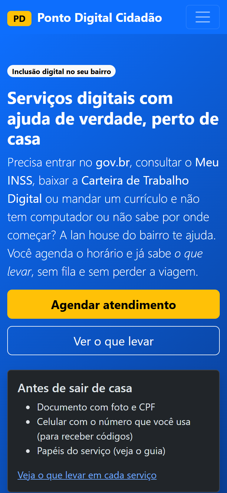 | 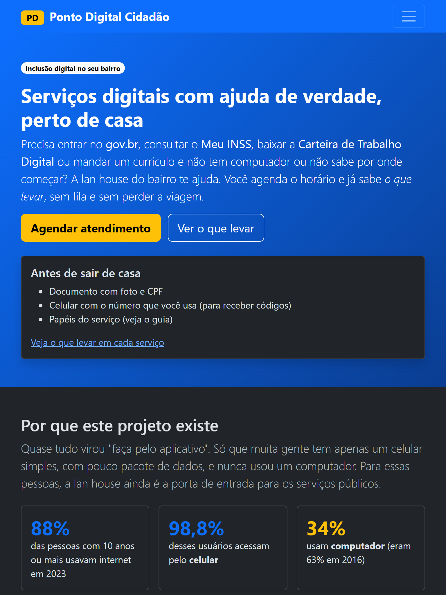 | 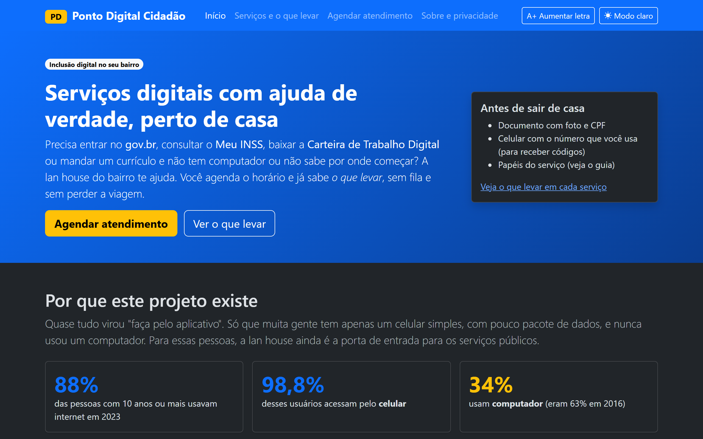 |
| **Serviços** | 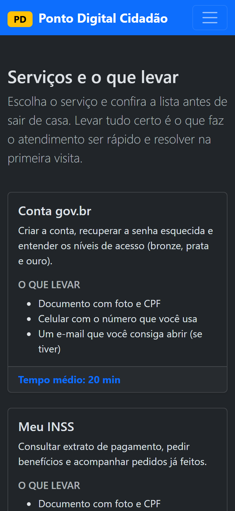 | 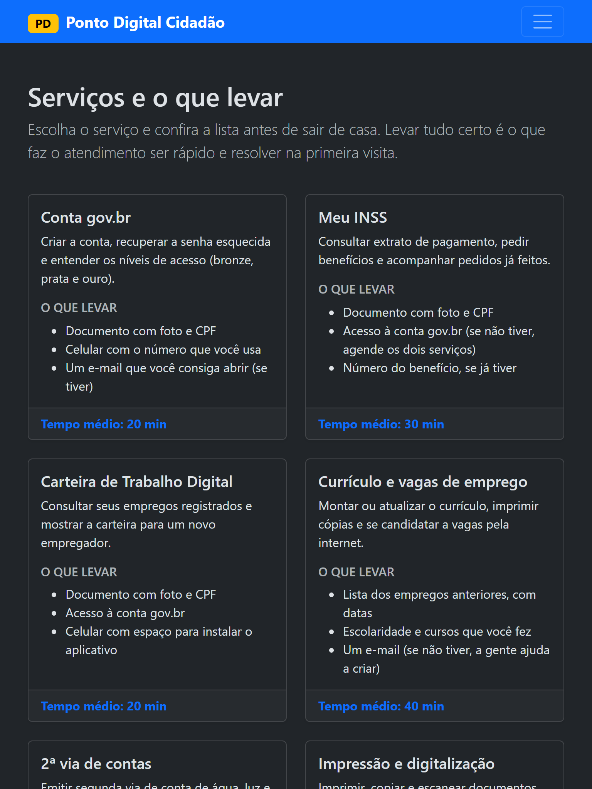 | 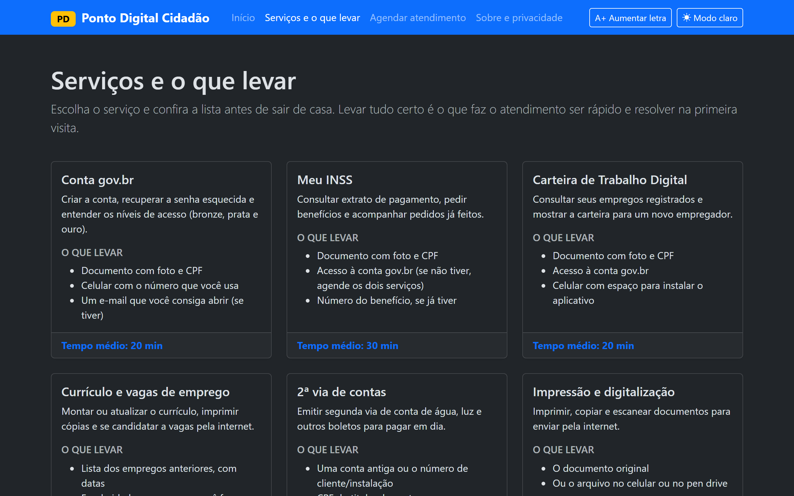 |
| **Agendar** | 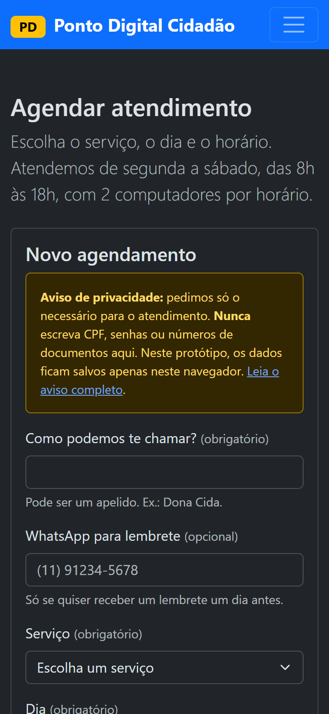 | 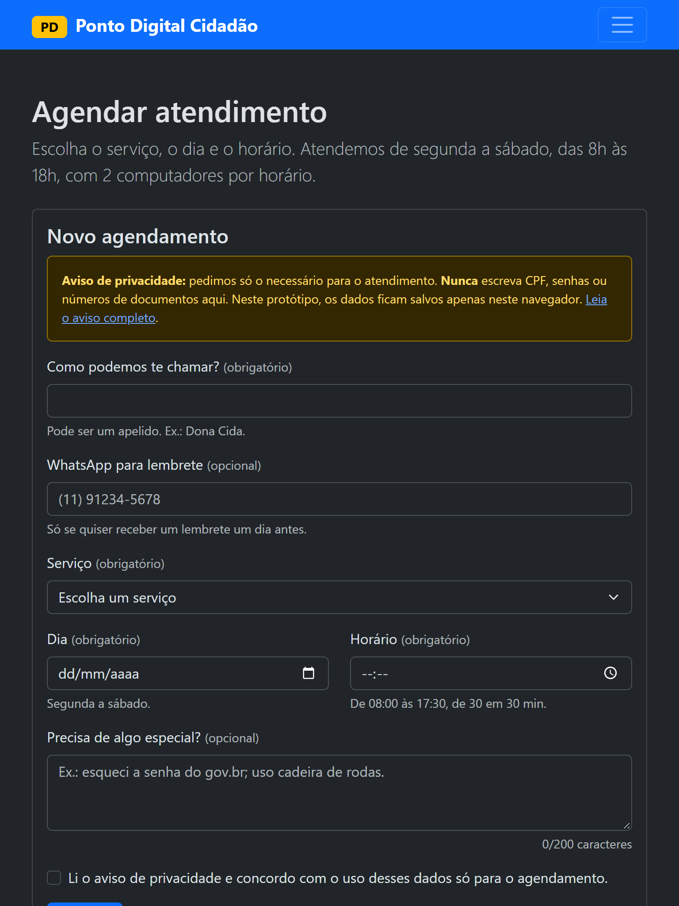 | 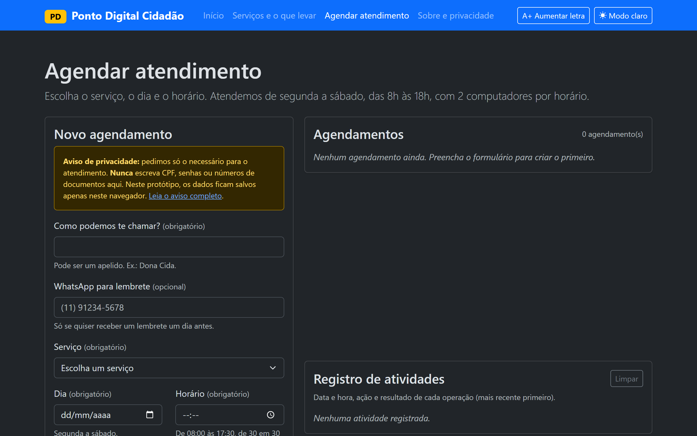 |
| **Sobre** | 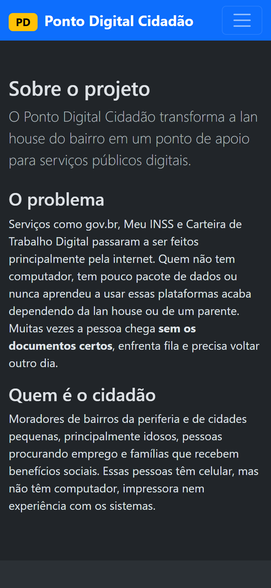 | 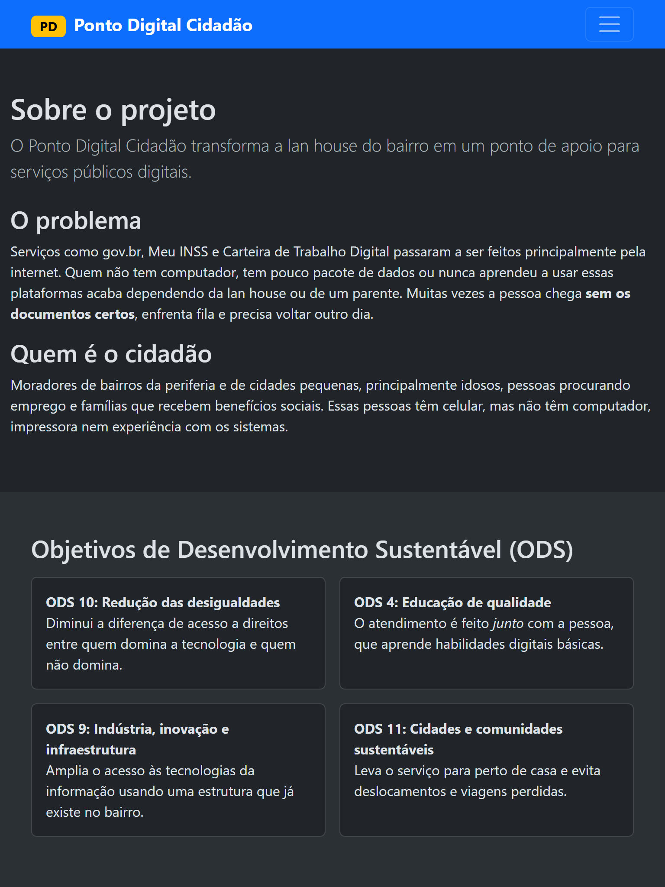 | 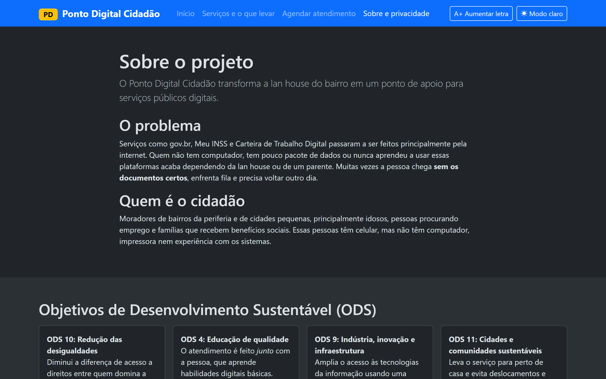 |

### Validação do formulário

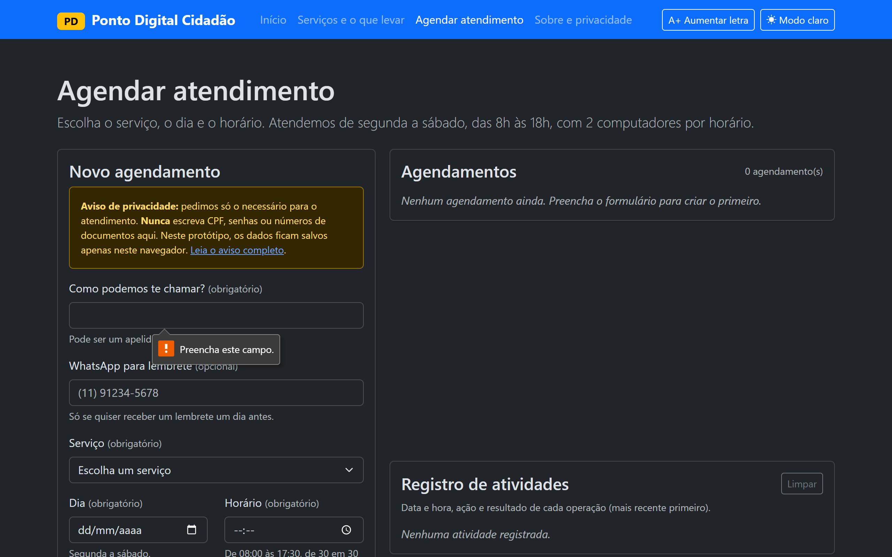

## Privacidade

Este é um protótipo acadêmico. Use **somente dados fictícios**. Os dados ficam apenas no navegador de quem usa o site; nada é enviado para servidores.

## Autor

Gabriel Moura, Desenvolvimento de Software Multiplataforma, 2026.